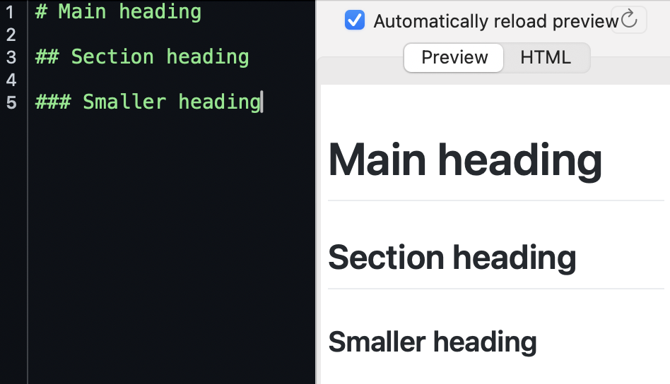
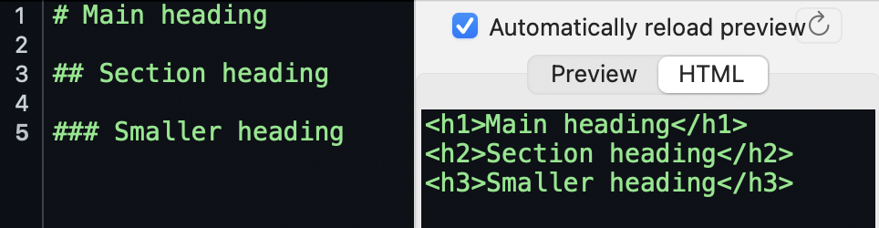

# Today's agenda

## Two short halves

:::: {.columns}
::: {.column width="50%"}
### First 30 minutes: Introduction

- Communication tools
- Markdown essentials
- *Quarto* file structure

:::

::: {.column width="50%"}
### Final 30 minutes: Practice

- Choose a document
- Prompt MS Copilot
- Save as `.qmd`
- Render, inspect, refine

:::
::::

# Communication tools

The Wider Picture

## Visual editors

:::: {.columns}
::: {.column width="30%"}
### Examples

- *Word*
- *PowerPoint*
- *Google Docs*
- *Canva*

:::
:::{.column width="30%"}
### Downsides
- proprietary
- local formatting

:::
:::{.column width="39%"}
### Upsides
- *What you see is what you get*
  - WYSIWYG
- easy to learn

:::
::::

## Mark-up systems

:::: {.columns}
::: {.column width="32%"}
### Examples

- HTML
- *LaTeX*
- *Typst*

:::
:::{.column width="32%"}
### Upsides

- plain text
- open-source
- easy to share

:::
:::{.column width="33%"}
### Downsides

- "steep" learning curve^[Technically, a shallow learning curve]

:::
::::

## Markdown

:::: {.columns}
::: {.column width="40%"}

### Origin (2004)

- [John Gruber](https://en.wikipedia.org/wiki/John_Gruber){target="_blank"} & [Aaron Schwartz](https://en.wikipedia.org/wiki/Aaron_Swartz){target="_blank"}
- felt raw html was onerous
- Hence, Mark***down***
  - *up* = complex
  - *down* = simple
- converts natively to HTML
  - its raison d'être

:::
:::{.column width="15%"}

### Upsides

- plain text
- easy to...
  - read
  - learn
  - share
  - render

:::
:::{.column width="45%"}
### Downsides

- By itself: Few bells and whistles
  - But *R Markdown* and *Quarto* add many back in
- not fully WYSIWYG
  - but 90% of the way there
  - a small price to pay (in my own view)

:::
::::

## Scientific publishing systems

Combine prose, code, and output specifications

::::{.columns}
:::{.column}
### For today (part of *RStudio*)

- *R Markdown*
- *Quarto*

:::
:::{.column}
### Others

- *Jupyter Notebooks*
- *Jupyter Books*
- *MyST Markdown*

:::
::::

## *R Markdown* and *Quarto*

:::: {.columns}
::: {.column width="48%"}
### *R Markdown*

- Introduced reproducible documents to many *R* users
- Uses `.Rmd` source files
- Inseparable integration with *R*
  - (you can't render without *R* installed)
- Still widely used

:::

::: {.column width="48%"}
### *Quarto*

- Newer, more language-neutral publishing system
- Uses `.qmd` source files
- Works with *R*, *Python*, *Julia* and *Observable JS*
  - hence *Quarto* (the four languages)
- Documents, slides, websites, books, dashboards
- Standalone (no *a priori* requirement to install *R*)

:::
::::

## A typical workflow for *Quarto* and *R Markdown*

1. Create a *Quarto* or *R Markdown* file in *RStudio*
2. Add
   a. Required
      1. YAML header
   b. And one, or the other, or both
      1. *Markdown*
      2. code (or *Python*, etc.)
3. Select **Render**
4. The chosen output is rendered
5. If necessary, edit the source, then render again

# A quick intro to Markdown

## Markdown: headings

::: {.panel-tabset}
### Rendered in a browser


### raw html


:::

## Markdown: emphasis

:::: {.columns}
::: {.column width="48%"}
### Raw Markdown

```markdown
*italics*

**boldface**

***bold italics***

`inline code like sd(data$reactionTimes`
```

:::
::: {.column width="48%"}
### Rendered

*italics*

**boldface**

***bold italics***

`inline code`

:::
::::

## Markdown: bullet points

:::: {.columns}
::: {.column width="48%"}
### Raw Markdown

```markdown
- First point
- Second point
  - Nested point
- Third point
```

:::
::: {.column width="48%"}
### Rendered

- First point
- Second point
  - Nested point
- Third point

:::
::::

## Markdown: quotations

:::: {.columns}
::: {.column width="48%"}
### Raw Markdown

```markdown
> Good communication makes
> analysis useful.
```
:::

::: {.column width="48%"}
### Rendered

> Good communication makes
> analysis useful.

:::
::::

## Markdown: links

:::: {.columns}
::: {.column width="75%"}
### Raw Markdown

```markdown
[my pres](https://patrickabolger.github.io/quartoWorkshop/){target="_blank"}
```
:::

::: {.column width="24%"}
### Rendered

[my pres](https://patrickabolger.github.io/quartoWorkshop/){target="_blank"}

:::
::::

::: {.callout-note}
`{target="_blank"}` is actually specific to *Quarto Markdown*, and opens links in new tabs instead of the same tab
:::

## Markdown: formulas (with LaTeX)

### LaTeX in Markdown

```markdown
This is the *F*-ratio: $F=\frac{MS_{between}}{MS_{within}}$

And in a little more detail:
$$
F=\frac{SS_{between}/df_{between}}{SS_{within}/df_{within}}
$$
```
### Rendered

This is the *F*-ratio: $F=\frac{MS_{between}}{MS_{within}}$

And in a little more detail:
$$
F=\frac{SS_{between}/df_{between}}{SS_{within}/df_{within}}
$$

# Quarto file structure

## Anatomy of a `.qmd` file

```markdown
---
title: "My report"
format: html
---

<!-- above is the YAML header -->

# Introduction

This is the **Markdown area**.

<!-- below is a code chunk -->

``{r}
summary(mtcars)
``
```

::: {.callout-note}
The code chunk should actually have 3 backticks, closed by 3 backticks as well. If I put 3 in for this demo, weird things happen. Also note that `<!-- these are unintepreted comments in markdown -->`
:::


## 1. YAML header

::::{.columns}
:::{.column width="40%"}

```yaml
---
title: "Student wellbeing summary"
author: "Patrick Bolger"
date: today
format:
  html:
    toc: true
---
```

:::

:::{.column width="60%"}

- Located at the very top of the file
- Begins and ends with `---`
- Stores document metadata and output settings
- Indentation matters (as in Python)

:::
::::

## 2. Markdown area

```markdown
# Introduction

This report summarises a small survey.

## Key findings

- Most respondents reported...
- The clearest pattern was...
```

- Prose and structure
- Images, simple tables, links, and citations
- Readable before rendering

## 3. Code blocks

```{r}
#| eval: false
#| echo: fenced
#| label: fig-scatter
#| fig-cap: "Miles per gallon by weight"

plot(mtcars$wt, mtcars$mpg)
```

- Fenced by three backticks
- `{r}` identifies the language^[This would be `{python}`, `{julia}`, and `{ojs}` for *python*, *julia*, and *Observable JS*, respectively]
- `#|` lines are chunk options^[The `eval: false` in the chunk options (`#|`) at top tells *R* not to run the code in that chunk. You wouldn't normally include this option in a finished product unless you were teaching.]
- Output appears in the rendered document

## One source, different outputs

Change the YAML rather than rewriting the content

:::: {.columns}
::: {.column width="32%"}
```yaml
title: "How to use Quarto"
author: "Patrick Bolger"
date: today
format: html
```
:::
::: {.column width="32%"}
```yaml
title: "How to use Quarto"
author: "Patrick Bolger"
date: today
format: 
  docx: default
  typst: default
```
:::
::: {.column width="32%"}

```yaml
title: "How to use Quarto"
author: "Patrick Bolger"
date: today
format: 
  revealjs: default
  pptx: default
```
:::
::::

::: {.callout-warning}
Not every design feature transfers perfectly between formats. Render early and inspect the result.
:::

::: {.callout-note}
Rendering to `.pdf` requires that you have some version of *LaTeX* installed. the easiest way to do this is to install the R package *tinytex*, which installs a minimal version of *LaTeX*.
:::

::: aside
When you have multiple output formats, click `Render` at the top and choose the output from the drop-down menu
:::

# Practice

## Part 1: Pick 1 or 2 output types {.smaller}

::::{.columns}
:::{.column width="27%"}

### non-pdfs

- `output: html`
  - webpage
- `output: revealjs`
  - html slide deck
- `output: docx`
  - MS *Word*
- `output: pptx`
  - MS *PowerPoint*

:::
:::{.column width="72%"}

### `output: pdf` (more difficult pdfs)
- this traditionally required installing *LaTeX*
- easiest to use the *tinytex* package in *R*
- but not today, unless you already have *LaTeX* installed

### `output: typst` (easier pdfs)
- *Quarto* can use *Typst* now
- *Typst* comes built in to *Quarto*
- New and under development

:::
::::

::: {.callout-warning}
If you choose 2 output types, make them the same type of document (e.g., `docx` and `typst`, or `revealjs` and `pptx`). This minimises incompatibility issues.
:::

## Part 2: Choose a small, familiar topic. 

Aim for:

- A title and format (YAML header)
- Two or three sections (Markdown)
- One short *R* code block (code chunk)

## Part 3: Create a project in *RStudio*

- `File > New Project`
- `File > New File > Quarto Document` (or `Quarto Presentation`)
  - This distinctions are just for initial convenience
  - The `output:` line in the YAML header determines the document output

# Use *MS Copilot* to get started

## Part 4: Build the prompt from four parts

1. **Goal**: what should Copilot create?
2. **Context**: audience and purpose
3. **Source**: content, data or code to use
4. **Expectations**: exact format and constraints

::: {.callout-tip}
Ask for the complete `.qmd` source in **one fenced code block**, with no missing sections and no invented data.
:::

## Copilot prompt template {.smaller}

>Create a minimal Quarto document for [AUDIENCE] about [TOPIC].
It will be edited and rendered in RStudio.
>
>Output format: [html / docx / pdf / revealjs].
Include: [TITLE], [2–3 SECTIONS], and one short R code block that
uses [BUILT-IN DATA / CODE I PROVIDE].
>
>Requirements:
>
> - Return the complete contents of one .qmd file.
> - Put the entire file in one fenced code block.
> - Include a valid YAML header.
> - Use simple Markdown.
> - Use only packages and data named in this prompt.
> - Do not invent results or references.
> - Keep it short enough to inspect line by line.
> - After the code block, give a three-item render checklist.

## Example student prompt

>Create a minimal Quarto HTML document for first-year psychology students about the relationship between sleep and concentration.
It will be edited and rendered in RStudio.
>
>Include a title, a short introduction, two sections, and one *R* code
block using only the built-in *mtcars* data to demonstrate a scatterplot.
Explain clearly that the dataset is only a coding demonstration and
is not evidence about sleep or concentration.
>
>Return one complete `.qmd` file in one fenced code block. Include a valid YAML header with a table of contents. Use simple Markdown. Do not invent
results, sources or packages. Finish with a three-item render checklist.

## Part 5: From *Copilot* to *Quarto*

1. Inspect the response for invented claims or unnecessary packages
2. Copy only the contents inside the code fence
3. In your default `.qmd`, delete all the starter text and save, typing in a reasonable file name
4. Paste the contents from the code fence in *Copilot*
5. Save again
6. Select **Render**
7. If there are errors, read them carefully, revise, and render again

## Part 6a: Debugging prompts

If rendering fails, paste the **exact error** into Copilot:

>This Quarto document fails to render. Explain the error in plain English, then return the smallest corrected version. Do not add new packages or features.
>
>[PASTE ERROR]
>
>[UPLOAD `.QMD`]

## Part 6b: Debugging prompts

If rendering works but looks poor:

>Keep the content and output format unchanged. Improve only the headings,
spacing and chunk options. Return the complete revised `.qmd` file.

## Before you finish, check for the following

- [ ] Valid YAML header
- [ ] Closing backticks present
- [ ] Required packages installed
- [ ] Data actually available
- [ ] Output renders
- [ ] Claims checked by you
- [ ] File names sensible

::: {.callout-important}
Copilot can draft the source. But naturally, ***you*** are responsible for the content, code, evidence and final output.
:::

# Summary

## *Quarto* turns a readable source file into professional communication.

- Markdown provides structure
- YAML controls the output
- Code blocks make results reproducible
- Copilot can accelerate a minimal first draft
- Rendering and checking remain human tasks

# Links

## Webpages and books

::::{.columns}
:::{.column}

### Webpages

- [R Markdown](https://rmarkdown.rstudio.com/){target="_blank"}
- [Quarto](https://quarto.org/){target="_blank"}
- [tinytex (to render to pdf)](https://yihui.org/tinytex/){target="_blank"}
- [Typst](https://typst.app/){target="_blank"}

:::
:::{.column}

### IDEs (Integrated Development Environment)

- [RStudio](https://posit.co/products/open-source/rstudio){target="_blank"}
- [Positron](https://positron.posit.co/){target="_blank"}
  - The company *Posit* is slowly moving away from *RStudio* and towards *Positron*, just as it's moving away from *R Markdown* and towards *Quarto*

:::
::::

## LinkedIn Learning (where you can earn badges to put on your CV)

- [Complete Guide to R: Wrangling, Visualizing, and Modeling Data (R Basics)](https://www.linkedin.com/learning-login/share?account=36922300&forceAccount=false&redirect=https%3A%2F%2Fwww.linkedin.com%2Flearning%2Fcomplete-guide-to-r-wrangling-visualizing-and-modeling-data%3Ftrk%3Dshare_ent_url%26shareId%3DpHygdm9ASziZV%252FewsqPBWw%253D%253D){target="_blank"}
- [Learning the R Tidyverse](https://www.linkedin.com/learning-login/share?account=36922300&forceAccount=false&redirect=https%3A%2F%2Fwww.linkedin.com%2Flearning%2Flearning-the-r-tidyverse-24332729%3Ftrk%3Dshare_ent_url%26shareId%3Dm0xWIVqXR8quPBvRAJbm%252BQ%253D%253D){target="_blank"}
- [Learning Markdown: Formatting Text without the Complexity](https://www.linkedin.com/learning-login/share?account=36922300&forceAccount=false&redirect=https%3A%2F%2Fwww.linkedin.com%2Flearning%2Flearning-markdown-formatting-text-without-the-complexity%3Ftrk%3Dshare_ent_url%26shareId%3DVBhsFETRQ8SBoZTINms4tg%253D%253D){target="_blank"}
- [Git Essential Training](https://www.linkedin.com/learning-login/share?account=36922300&forceAccount=false&redirect=https%3A%2F%2Fwww.linkedin.com%2Flearning%2Fgit-essential-training-25677984%3Ftrk%3Dshare_ent_url%26shareId%3D%252Bd4xxHopRxGlDGHqJseccQ%253D%253D){target="_blank"}
  - (for collaboration; *git* is like *dropbox*, but with each step of the process )

:::Aside
Nothing on *R* in *Quarto* yet; just a course on [using *Python* in *quarto*](https://www.linkedin.com/learning-login/share?account=36922300&forceAccount=false&redirect=https%3A%2F%2Fwww.linkedin.com%2Flearning%2Fdata-science-reporting-with-quarto-for-python%3Ftrk%3Dshare_ent_url%26shareId%3DLbFKOOX4TLSXrDE2E5C3IQ%253D%253D){target="_blank"}
:::

## Books

